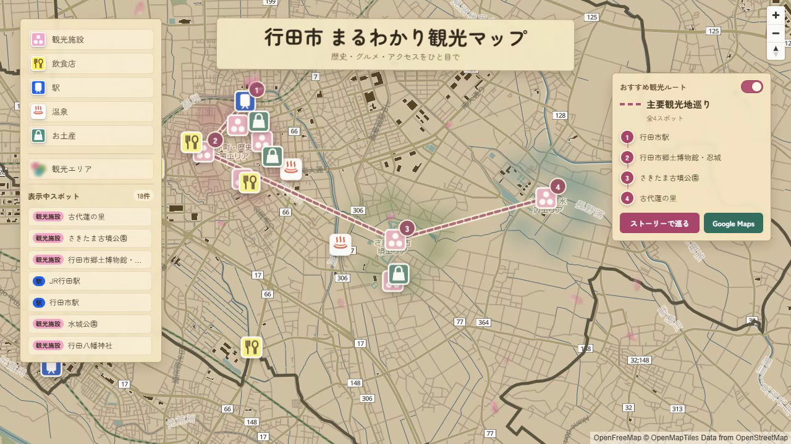

# 行田市まるわかり観光マップ
### 利用者参加による観光情報の補完を目指すWeb観光マップの構築と評価（卒業論文草稿）

**青山学院大学 地球社会共生学部／2026年度卒業研究**

> **執筆状況（2026年11月4日時点）**：IMRaD形式に整理した研究途中の草稿です。システムの実装結果と、今後実施する利用者調査・比較評価は明確に区別しています。利用者投稿が既存観光情報を補完できたという結論は、まだ得られていません。

- [公開Web観光マップ](https://furuhashilab.github.io/2026gsc_ShotaArakawa/)
- [地図への書き込み試作（別リポジトリ）](https://furuhashilab.github.io/Hackathon_Oct_ShotaArakawa/)
- [既存参加型マップのレビュー（Issue #4）](https://github.com/furuhashilab/2026gsc_ShotaArakawa/issues/4)
- [既存観光Webマップの成功事例レビュー（Issue #5）](https://github.com/furuhashilab/2026gsc_ShotaArakawa/issues/5)
- [2025年度ゼミ論](https://github.com/furuhashilab/2025gsc_ShotaArakawa)

## Abstract（概要・暫定）

観光Webマップは、観光資源の位置情報の提示に加え、周遊促進や混雑緩和などの地域課題への対応に利用されている。一方、観光情報の収集・選定は各媒体の運営主体や掲載方針に左右されるため、地域住民や来訪者が持つ情報によって、既存の観光案内を補完できる可能性がある。本研究では埼玉県行田市を対象として、利用者がスポット、散策ルート、エリア等を提案できる参加型Web観光マップを構築し、その有用性を検証する。比較基準には行田おもてなし観光局の「行田観光NAVI」の観光スポット・飲食店・買い物・宿泊・モデルコースを用い、独立掲載・モデルコースの主要地点・周辺紹介のみ・比較対象への未掲載を区別して評価する。公式観光パンフレットは補助的に今後調査する。現段階では観光マップ本体、文章・写真投稿フォーム、地図への書き込み機能、既存スポットの編集・公開機能を試作している。ただし、投稿受付から新規情報のオンライン公開までの一貫した運用と、利用者投稿による情報補完効果は未検証である。

**キーワード：** 観光Webマップ、参加型地図、地域資源、Volunteered Geographic Information（VGI）、行田市、MapLibre GL JS

---

## I. Introduction（研究背景・目的）

### 1.1 観光Webマップの役割の多様化

近年、観光Webマップは、観光スポットの位置を示すための媒体にとどまらず、地域ごとの課題を解決する手段として活用されている。箱根観光デジタルマップは交通混雑の緩和と観光客の周遊促進を目的とし、観光・交通情報を一体的に提供している[1][2]。嵯峨嵐山周遊ガイドは、特定の有名観光地への集中を緩和し、周辺エリアへの分散観光を促すことを目的としている[3]。宇治観光デジタル・イラスト・マップでは、広域周遊の促進、紙媒体の情報更新の制約への対応、観光データの活用が重視されている[4]。祇園祭宵山ガイドは、イベント期間中の通行規制や山鉾の位置を伝え、安全かつ快適な観覧を支援することを目的としている[5]。

これらの事例は、Webマップの機能や表現方法が地域の具体的な課題と結びついていることを示す。一方、本研究が特に注目するのは、地図の閲覧機能だけでなく、**「地図に掲載される観光情報は誰が、どのように集め、選定するのか」**という点である。既存事例の目的・運営主体・機能・報告された成果は[Issue #5](https://github.com/furuhashilab/2026gsc_ShotaArakawa/issues/5)に整理した。なお、利用者数や観察された行動の違いを、地図の因果的な効果と同一視しない。

### 1.2 観光情報の収集・選定と掲載機会

自治体や観光協会などが運営する観光情報媒体では、各団体の編集方針や事業者との連携を通じて紹介内容が形成される。観光協会の会員制度が、情報媒体への掲載機会と関係する例も存在する。郡山市観光協会は、協会が制作する観光マップなどへの事業所位置の掲載を会員向けのメリットとして案内している[6]。中央区観光協会も、ガイドマップの会員紹介欄への掲載を会員特典として挙げている[7]。

行田市においても、行田おもてなし観光局の令和5年度事業報告では、会員の市内飲食事業者と連携してグルメパンフレットを発行したことが記載されている[8]。また、同観光局の公式サイトでは、有料バナー広告の掲載について会員を優先する方針が示されている[9]。

ただし、**これらの資料は「非会員の店舗が観光マップに掲載されない」ことや、「行田市の通常の観光スポット掲載が会員優先である」ことを示すものではない**。有料広告、会員紹介欄、一般の観光情報を区別する必要がある。したがって本研究は、既存の観光案内に欠陥があることを前提とせず、**利用者が提供する情報によって既存の掲載内容に何が追加され得るのか**を調査・検証する。

### 1.3 利用者参加型マップと地域資源の再発見

情報収集の入口を地域住民や来訪者にも広げた事例として、「松江のお気に入りマップ」と「しろい写真投稿マップ」がある。前者は地域の好きな場所や風景を写真・位置情報とともに募集して観光ブランドづくりに活用する取り組みであり[10]、後者は市民からの写真・位置情報を市職員が確認した上で地図に公開する仕組みを持つ[11]。両者の投稿方法や管理体制の違いは[Issue #4](https://github.com/furuhashilab/2026gsc_ShotaArakawa/issues/4)で比較した。

学術的には、Goodchild（2007）は、市民が自発的に地理情報を提供するVolunteered Geographic Information（VGI）という概念を論じている[12]。土居ほか（2021）は、地域の生活者との協働によるマップづくりと、地域資源の再発見・再認識について検討している[13]。また、福山・西山（2021）は、未利用地域資源の観光まちづくりへの活用プロセスを分析している[14]。

これらは利用者の視点や地域に埋もれた情報を取り入れる意義を考える手がかりになる。ただし、先行研究や参加型マップの存在だけで、**行田市において未掲載の有用な観光スポットが利用者投稿から発見される**と結論づけることはできない。そこを実際に比較することが本研究の課題である。

### 1.4 対象地域・既存の観光情報と研究上の問い

対象地域は埼玉県行田市とする。既存観光情報の主な比較対象には、行田おもてなし観光局の[「行田観光NAVI／行田たびナビ」](https://www.gyoda-kankoukyoukai.jp/)に掲載された**観光スポット、グルメ、お土産、宿泊、モデルコース**の5カテゴリを採用する。施設・店舗だけでなく、モデルコースの主要立ち寄り地点や周辺への簡易な言及も別の掲載形態として記録する。公式パンフレットも補助的に比較する予定である。

イベント・ツアー・体験予約商品は、地点情報とは性質や更新頻度が異なるため、主たる比較対象から除外する。所在地が行田市外と確認された施設は記録を残しつつ、市内スポットの比較には含めない。基準の抽出日は2026年11月4日とし、対象媒体の範囲を固定する。

本研究の中心的な問い（Research Question：RQ）は以下である。

> **RQ：利用者参加型Web観光マップは、行田市の既存観光案内で十分に紹介されていない場所や、既存スポットについての新たな情報・散策ルートを収集し、観光情報を補完できるか。**

作業仮説は、利用者投稿には、独立した紹介や主要ルートで案内されていない場所、既存スポットの新たな楽しみ方、既存モデルコースにない散策経路が含まれるというものである。「まったく未掲載」と「名称のみの簡易な掲載」を分けて検証する。

### 1.5 研究目的

本研究は、行田市を対象に、地図・写真・動画・観光ルートによる情報発信機能と、利用者による情報投稿および管理者の確認・更新機能を持つWeb観光マップを構築し、**既存の観光案内を利用者の声で補完できるか**を検証することを目的とする。

主評価は「既存案内にない情報の収集」と「その情報の有用性」とし、投稿の操作性や少人数での更新のしやすさは補助的な評価とする。**「参加型の仕組みを実装したこと」自体ではなく、収集した情報の内容を比較・分析すること**を研究の中心に置く。

---

## II. Methods（研究方法）

### 2.1 既存観光Webマップのレビュー

まず、目的・運営主体・利用者参加の有無・情報提供方法・掲載判断・運用上の特徴を共通の観点として、箱根、嵯峨嵐山、宇治、祇園祭、松江、白井の6事例を比較した。各事例の詳細と出典は[Issue #4](https://github.com/furuhashilab/2026gsc_ShotaArakawa/issues/4)および[Issue #5](https://github.com/furuhashilab/2026gsc_ShotaArakawa/issues/5)を参照する。このレビューは研究の背景を整理するための事例調査であり、6事例から全国の観光マップ全般を統計的に代表させるものではない。

### 2.2 比較対象となる行田市の既存情報の整理【基準データ作成済・地点照合は継続】

行田たびナビの5カテゴリを、2026年11月4日の公開情報に基づいて台帳化した（[Issue #6](https://github.com/furuhashilab/2026gsc_ShotaArakawa/issues/6)）。抽出件数は観光スポット20、グルメ63、お土産26、宿泊7の**計116掲載行**と、モデルコース11件である。116掲載行には同一施設が別カテゴリに掲載された5組を含み、名寄せ後は111件となる。公式掲載住所が熊谷市の2件を除くと109件だが、この数値を固定の点施設数とは扱わない。

名称、公式カテゴリ／ジャンル、所在地・コースの立ち寄り地点、説明要約、個別掲載URL、取得日・更新日を記録した。情報源の掲載ページは日付を固定し、表記揺れ・同名異施設・複数カテゴリへの掲載を照合する。モデルコースは**コース自体を施設数に加算せず**、その中で主要な立ち寄り地点として明示された場所と、周辺紹介に名称だけ登場する場所を区別する。これらの地点の名寄せ・分類は今後実施する。

原則として開催日時が限定されるイベント、ツアー・体験商品の予約案内および下位予約サイト「行田 旅の手帖」の商品は主たる照合対象に含めない。市外施設2件は掲載の事実を残し、市内比較から除外する。紙の観光パンフレットは版・発行時期を明示して今後別途調査する。**「比較対象の5カテゴリに掲載がない」は「公式サイトの全ページや他の観光情報にも存在しない」と同義ではない。**

### 2.3 観光Webマップ本体の構築

HTML・CSS・JavaScriptとMapLibre GL JSを用い、OpenStreetMap由来の地図データを背景に、行田市内のスポットをカテゴリ別に可視化した。スポットは元データ（data/spots.json）を基礎とし、観光地、飲食店、駅、温泉、お土産等に分類する。ピンまたは一覧から詳細カードを表示し、情報がある場合に写真、説明文、短尺動画、Vlog、公式サイトへのリンクを提示する。行田市の境界と観光エリアも表示し、推薦ルートとGoogle Mapsへの経路案内リンクによって周遊を支援する。

2025年ゼミ論で扱った動画連携を基盤として残しつつ、2026年度は利用者からの情報収集とその管理・反映に重点を移している。

### 2.4 利用者からの情報投稿と管理体制

投稿経路として、次の**独立した2方式**を試作した。

| 方式 | 投稿可能な情報 | 保存・管理方法 | 現時点の状態 |
| --- | --- | --- | --- |
| [Googleフォーム](https://docs.google.com/forms/d/e/1FAIpQLSdADYHqjtGAR34llFte1ydv7acGpSJ2xDD3q-FK5lg8UreQkw/viewform) | おすすめ、掲載情報の訂正、感想、任意の写真などの文章投稿 | Googleスプレッドシートのフォーム回答タブで受付・確認 | **受付を試作済み**。写真のアップロードにはGoogleログインが必要 |
| [Terra Draw書き込みマップ](https://furuhashilab.github.io/Hackathon_Oct_ShotaArakawa/) | 地図上の地点（点）、散策ルート（線）、おすすめエリア（面）と説明 | Google Apps Scriptで受信し、別タブに保存。管理画面で確認・GeoJSONを個別保存 | **投稿・確認・書き出しを試作済み**。観光マップ本体とは別サイト |

投稿内容は自動的に一般公開せず、管理者が確認・選別して必要な情報を反映する設計とした。観光マップ本体にはSupabase Auth・PostgreSQL・Storageを使った管理画面があり、**既存スポットの文章・写真等の下書き保存、公開前確認、公開、直前公開の取り消し**ができる。一方、**新しいスポットや投稿GeoJSONをオンラインでそのまま公開する機能、2つの投稿方式への統合導線は未実装**である。投稿後の確認・掲載工程は現在、手動操作を伴う。

### 2.5 投稿情報と既存情報の比較・評価【計画】

行田市を知る住民・来訪者などから研究参加への同意を得て、スポットやルートの投稿を募る。参加者数、募集方法、募集期間、行田市との関係、投稿条件は実施前に定め、実施時に記録する。現時点では本実験の評価件数は確定していない。

投稿された**場所**は次の優先順位で主分類を1つ判定する。A1・A2・C1・C2は**研究独自の評価コード**であり、行田たびナビの公式カテゴリとは異なる。

| 判定 | 研究独自の分類 | 判定基準 |
| --- | --- | --- |
| **A1** | 独立掲載スポット | 観光スポット・グルメ・お土産・宿泊に、その場所を紹介する個別ページがある。 |
| **A2** | モデルコースの主要地点のみ掲載 | A1には該当せず、モデルコースの**主要な立ち寄り地点**として紹介されている。 |
| **C1** | 周辺紹介のみ・簡易言及 | A1・A2には該当しないが、モデルコース本文の周辺紹介などで**名前だけ／説明が乏しい形**で触れられている。完全未掲載とは区別する。 |
| **C2** | 比較対象に未掲載 | A1・A2・C1のいずれにも該当しない。これは**対象とした5カテゴリに未掲載**という限定的な意味である。 |

さらに、**B：既存地点への追加情報**はA1・A2・C1の主分類と重複して付与できる。既存の説明にない見どころ、体験、季節・時間帯、撮影位置などの追加情報を確認し、その有用性を評価する。**D：新しいルート・エリアの提案**は点とは別に評価し、既存モデルコースと一致・部分一致・新規提案を区別する。

例として、[足袋蔵めぐり](https://www.gyoda-kankoukyoukai.jp/model/2462)の主要立ち寄り地点「時田家住宅・時田蔵」は、A1の独立ページがなければA2候補となる。一方、周辺紹介で名称中心に挙げられる「田代蔵」「草生蔵」などは、ほかのページでA1・A2に該当しない限りC1候補となる。**同じ場所が複数箇所に掲載されているときは、A1→A2→C1の順に優先する。**

主指標は、重複を除いた投稿地点数、A1・A2・C1・C2の件数・割合、既存情報の記載を補完するBの件数、Dのルート一致状況、有用と判断できた投稿の件数とする。**「未掲載スポット数」と発表するのはC2のみ**とし、C1とC2を合わせて示すときには「独立・主要地点として詳しく案内されていないスポット」と明示する。

有用性の判定では、実在性、訪問・観賞可能性、位置の特定可能性、投稿内容の正確性、写真等の利用許可を確認する。公式サイトに掲載があるだけでは現時点の営業を保証しない。補助的に投稿完了率・操作負担・管理者の確認時間を測定する。「利用者が情報にリーチしにくい」という仮説は、必要に応じクリック数や操作テスト等で別途検証する。

### 2.6 倫理・著作権・個人情報の取扱い

投稿の研究利用と一般公開は分け、投稿者への説明と適切な同意、写真の権利確認、人物や私有地などへの配慮を行う。Googleフォームは氏名・メールアドレスを独立した質問項目として収集しない設定だが、**写真添付時はGoogleアカウントへのログインが必要であり、完全匿名とは説明しない**。公開する情報には、個人を特定できる内容や未許諾の写真を含めない。投稿内容の確認、掲載判断と保存・削除のルールは今後整備する。

---

## III. Results（結果：現時点の進捗）

> **注意：** 本節は2026年11月4日時点の実装・事例レビューの進捗報告であり、利用者参加が既存観光情報を補完したという実験結果ではない。投稿実験と既存案内との定量比較の結果は未取得である。

### 3.1 Web観光マップの実装状況

行田市周辺の位置・カテゴリ・写真・動画・周遊ルートを一つのWeb画面で提示できる観光マップを構築した。PC・スマートフォン向けの詳細カード、カテゴリごとの表示切替、現在地からGoogle Mapsへの案内リンク、古地図風の配色などを実装した。管理者向けには、既存スポットの下書き・公開・写真管理を備えている。実装の詳細と制限事項は[管理画面のドキュメント](docs/online-drafts.md)等に記載する。

利用者参加に関しては、文章・写真を送信するフォームと、点・線・面のGeoJSONを投稿する別マップを試作した。地図投稿の管理画面では、投稿単位・図形単位でGeoJSONを保存できる。**投稿データが自動的に公開観光マップへ反映されるわけではない。**

### 3.2 既存6事例の予備的レビュー

事例レビューから、通年型の観光Webマップには周遊促進や混雑分散、期間限定の案内には安全な移動支援など、異なる目的が認められた。松江・白井の事例には、市民・来訪者が情報提供する参加型の仕組みがある。したがって、**情報投稿機能そのものを本研究の独創的な発明と位置づけることはできない**。一方で、行田市の既存情報に対して、実際の利用者投稿がどのような新しい情報を提供するかについては、別途検証する余地がある。

### 3.3 既存観光情報の基準データ（取得済）と投稿による補完効果【未評価】

2026年11月4日時点の比較基準として、行田たびナビの5カテゴリについて**127掲載行（施設・店舗等116行＋モデルコース11件）**を整理した。地点施設116掲載行を同一施設の別カテゴリ掲載5組で名寄せすると111件で、熊谷市の住所が掲載されている2件を除くと109件となる。ただし、店舗営業が固定されないものや線状の緑道などもあるため、109件を固定的な観光施設数と解釈しない。モデルコース内の各地点についてA2とC1の区別・名寄せはこれから実施する。詳しい台帳と出典は[Issue #6](https://github.com/furuhashilab/2026gsc_ShotaArakawa/issues/6)を参照する。

利用者からの本実験投稿を用いた照合、A1・A2・C1・C2の割合、追加情報Bの有用性、ルート・エリアDの検証は未実施である。**既存掲載情報を収集できたことと、参加型マップによる補完効果を示したことは異なる。**

## IV. Discussion（考察：検証前の論点）

### 4.1 既存情報を補完する可能性

行政や観光協会の観光情報には、正確な案内や運営主体による確認という利点がある。一方で、住民や来訪者からの提案には、地元で親しまれる場所、日常の風景、季節ごとの体験、散策ルートなど、既存情報とは異なる視点が含まれる可能性がある。本研究では、そうした提案の**新規性と有用性を、既存情報との照合によって検証**する。

なお「観光協会の会員特典として情報掲載の機会がある」ことと、「会員以外が既存観光案内から除外されている」ことは異なる。既存の運営主体を一律に否定せず、その掲載内容を利用者投稿が補完する可能性として議論する。

### 4.2 利用者参加と情報の信頼性・運営負担

参加型の情報収集には、投稿の重複、誤情報、不適切な内容、写真の権利、更新作業の負担が伴い得る。公開前に管理者が確認する方式はこれらへの対応策になり得るが、**確認作業そのものの負担が増える可能性**もある。現状では個人での管理を想定しており、卒業後の継続運用、Googleサービスの所有権、無料枠への依存なども課題となる。

### 4.3 本研究の位置づけと限界

既存の参加型マップとの差は、投稿機能の新規性ではなく、**「比較対象を明示し、利用者投稿が従来の観光情報をどの程度補完するか」を評価しようとする点**に置く。飲食店から景観・散策ルートまで情報全般を対象にし、点・線・面を扱うことも特徴の一つである。

もっとも、本研究で扱う対象地域は行田市であり、募集方法や参加者属性、比較に使用する公式媒体の範囲によって結果は変わり得る。短期間の操作テストだけで長期的な運営可能性を証明することもできない。結果の一般化には慎重である必要がある。

### 4.4 今後の検証課題

今後は、(1) モデルコース11件の**主要立ち寄り地点（A2候補）と周辺紹介（C1候補）**の抽出・名寄せ、(2) 公式観光パンフレットの版と掲載情報の調査、(3) 利用者投稿の収集、(4) A1・A2・C1・C2の照合と追加情報B・ルートDの有用性評価、(5) 操作性と管理工数の測定、(6) 新規スポットの公開導線・運用ルールの整備を進める。実験の数値と観察結果が得られた段階で、考察を仮説から検証結果に基づく記述へ更新する。

## V. Conclusion（結論・暫定）

本研究では、行田市を対象として、地図・写真・動画・観光ルートを統合したWeb観光マップと、利用者の提案を受け付ける仕組みの構築を進めている。既存マップのレビューからは、Web観光マップの目的や運営体制が多様であること、利用者参加による情報収集自体には先行事例があることが確認された。

**2026年11月4日時点の既存観光案内の基準データを整理したが、利用者から収集した情報がこれをどの程度補完できるかについては、今後の比較調査によって検証する。** 現時点では研究目的と評価方法を明確化した段階であり、参加型マップの効果を実証したとの結論は出していない。

---

## 参考文献・参考資料（暫定）

以下は研究背景・事例レビューに用いた資料である。論文の最終稿では、著者名・発行日・正式タイトル・閲覧日等を確認し、引用スタイルを統一する。

1. [箱根温泉DX推進コンソーシアム／観光DX事例](https://kanko-dx.go.jp/case-study/1103/)：混雑分散・周遊促進の事業目的。
2. [日本政府観光局（JNTO）／箱根DMOの取組事例](https://www.jnto.go.jp/projects/regional-support/casestudy/3939.html)：利用状況と運営上の工夫。
3. [京都市観光協会（2024）／嵯峨嵐山における局所的な混雑緩和の取組](https://www.kyokanko.or.jp/news/20241029)。
4. [観光DX優良事例／宇治市観光協会「デジタルマップ導入による観光客の周遊促進とデータ活用」](https://kanko-dx-hojo.go.jp/cases/271)。
5. [京都市（2026）／京都府警察と連携した祇園祭の観覧環境向上のための取組](https://www.city.kyoto.lg.jp/sankan/page/0000355365.html)。
6. [郡山市観光協会／会員募集・会員特典](https://www.kanko-koriyama.gr.jp/members/info.html)。
7. [中央区観光協会／観光協会のご案内・会員特典](https://www.chuo-kanko.or.jp/pages/guide)。
8. [行田おもてなし観光局／令和5年度事業報告（PDF）](https://www.gyoda-kankoukyoukai.jp/wp-content/uploads/2025/05/18adeb1eaf41fe52d0f221bbfc139c73.pdf)。
9. [行田おもてなし観光局／広告募集について](https://www.gyoda-kankoukyoukai.jp/adinfo.html)。
10. [株式会社エブリプラン／松江のお気に入りマップの募集・運営の案内](https://www.citydo.com/prf/shimane/matsue/event/107819/)。
11. [白井市／しろい写真投稿マップの投稿手順](https://www.city.shiroi.chiba.jp/soshiki/seisaku/s07/hisyo011/hik021/14961.html)。
12. Goodchild, M. F. (2007). [Citizens as sensors: the world of volunteered geography](https://doi.org/10.1007/s10708-007-9111-y). *GeoJournal, 69*, 211–221.
13. 土居詩歩ほか（2021）．[生活者との協働に基づく地域資源を活用した地域活性化に資するマップづくり](https://doi.org/10.11247/jssd.68.0_386)．日本デザイン学会第68回春季研究発表大会．
14. 福山貴史・西山徳明（2021）．[未利用地域資源の活用による観光まちづくりの発展プロセス](https://doi.org/10.11361/journalcpij.56.1231)．*都市計画論文集，56*(3)，1231–1238．
15. [行田おもてなし観光局／行田観光NAVI](https://www.gyoda-kankoukyoukai.jp/)。
16. [行田おもてなし観光局／観光パンフレット一覧](https://www.gyoda-kankoukyoukai.jp/download.html)。

---

## 付録A：制作・運用の状況（研究用メモ）

### 地図本体の機能

- MapLibre GL JSによるWeb地図、行田市の行政境界と観光エリアの表示
- 観光施設・飲食店・駅・温泉・お土産のカテゴリ別マーカーと表示切替
- ピン・一覧の選択から開く詳細カード（写真、説明、短尺動画、Vlog、公式サイト）
- 推薦ルート：行田市駅 → 忍城 → さきたま古墳公園 → 古代蓮の里
- Google Mapsとの経路案内連携、スマートフォン向けパネル開閉
- 古地図・紙地図風の配色と蓮の花びら演出

### 管理機能と運用上の注意

- [管理画面](https://furuhashilab.github.io/2026gsc_ShotaArakawa/editor.html)：既存スポットのカード編集、オンライン下書き・公開・直前公開の取り消し
- [GeoJSON管理画面](https://furuhashilab.github.io/2026gsc_ShotaArakawa/geojson.html)：点・線・面の取り込み、編集、**未公開**プレビュー
- [オンライン下書き・公開仕様](docs/online-drafts.md)
- [写真の公開](docs/photo-publication.md)／[非公開写真の削除](docs/private-photo-deletion.md)／[失敗コピーの整理](docs/failed-photo-cleanup.md)
- [サーバー設定・セキュリティ・テスト](docs/server-setup.md)

公開マップは既存スポットの公開済みカード情報をSupabaseから取得する。カード内容の変更ごとにGitHubへプッシュする必要はないが、コードや地図UIの変更にはGitHubへの反映が必要。観光マップ本体に残る投稿UIは端末内保存の**デモ**であり、別途作成したGoogleフォームやTerra Draw投稿ページへの統合は未実装である。

### 2025年度ゼミ論からの発展

2025年度は写真・動画による観光スポットの紹介に取り組んだ。2026年度は詳細カードやカテゴリ別アイコン、スポット一覧、観光エリア表示、推薦ルート、スマホ向けUI、古地図風デザインなどを追加し、**利用者参加による観光情報の収集と更新**へ研究の焦点を広げた。

### 技術構成

HTML、CSS、JavaScript、MapLibre GL JS、OpenFreeMap／OpenStreetMap、GeoJSON、Google Maps URL連携、GitHub Pages、Supabase（Auth／PostgreSQL／Storage／Edge Functions）。地図投稿の別システムではTerra Draw、Google Apps Script、Googleスプレッドシートを使用する。

### ファイル構成（主なもの）

| ファイル・ディレクトリ | 役割 |
| --- | --- |
| index.html / style.css / main.js | 公開観光マップの画面・デザイン・地図処理 |
| editor.html / geojson.html | カード・写真管理／GeoJSONの未公開編集・プレビュー |
| data/spots.json | 固定ID付きの既存スポット元データ |
| js/ / css/ | 管理画面・写真管理等の処理とスタイル |
| supabase/ | SQLマイグレーションとEdge Functionsのソース |
| tests/ | 自動テスト |
| gyoda-style.json | 地図スタイル |
| gyoda_geojson.geojson | 行田市境界 |
| tourism-areas.geojson / tourism-area-glow.geojson | 観光エリア表示 |
| assets/ / docs/images/ | 画像等の素材 |
| legacy/ ほか | 2025年度の実装・地図関連資料 |

### ライセンス・データ出典

- 地図ライブラリ：MapLibre GL JS
- 地図データ：© [OpenStreetMap contributors](https://www.openstreetmap.org/copyright)
- ベクトル地図：OpenFreeMap／OpenMapTiles
- ライセンス情報：[LICENSE.md](LICENSE.md)
- 写真・動画などの掲載権限は素材ごとに確認し、第三者素材の利用許諾が得られたものとして扱わない。
